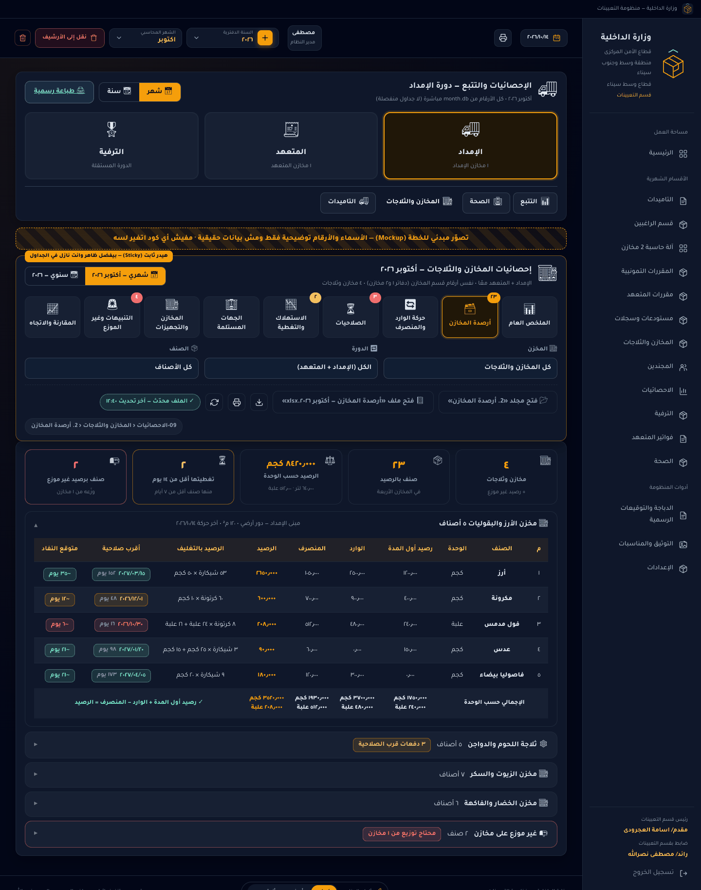

# 🏬 خطة تطوير «إحصائيات المخازن والثلاجات»: تابات فرعية وفولدر وإكسل حي لكل تاب (شهري وسنوي)

**التاريخ:** ١٤/١٠/٢٠٢٦
**المرجع:** توجيهك «اعمل الخطة كلها بس تكون متقسمة تابات فرعية وهيدر فيه التابات الفرعية … لا تنسى السنوي والشهري»
**المكان:** قسم ٠٩ «الإحصائيات والتتبع» ← تاب «المخازن والثلاجات» (`/stats` · فولدر `09-الاحصائيات`)
**الحالة:** ✅ اتوافق عليها واتنفذت المراحل ١–٤ — المرحلة ٥ مؤجلة

---

## الخلاصة
1. تاب «المخازن والثلاجات» في الإحصائيات هيتقسم **٩ تابات فرعية**. فوقهم **هيدر ثابت** فيه العنوان، ومفتاح شهري/سنوي، والتابات التسعة بأرقام صغيرة عليها، والفلاتر، وأزرار الملفات والطباعة. وتحت الهيدر بتظهر **بيانات التاب اللي اخترته بس**.
2. كل تاب فرعي **ليه فولدر خاص** جوه `09-الاحصائيات/المخازن والثلاجات/`. وجوه كل فولدر **ملف إكسل بنفس أعمدة الشاشة**، يعني اللي على الورق هو نفسه اللي في الإكسل.
3. ملفات **الشهري** بتتحفظ في فولدر الشهر. وملفات **السنوي** بتتحفظ في فولدر سنوي جديد اسمه `00-السنوي`، جنب فولدرات الشهور وبنفس الترتيب بالظبط.
4. الملفات **بتتحدث لوحدها** في ٣ حالات: بعد أي حفظ يأثر على المخازن، ولما تفتح التاب، وأول مرة تفتحه في يوم جديد. ولو الملف مفتوح في Excel، هيتحدث أول ما تقفله.
5. كل تاب ليه **زرار طباعة رسمية**: الدباجة فوق والتوقيعين تحت.
6. هنصلح كمان **٦ أخطاء في الحسابات** لقيتها في إحصائيات المخازن الحالية. وفيه **١٢ اقتراح إضافي** كلهم اختياريين.

---

## 🖼️ صورة توضيحية للشكل المقترح قبل التنفيذ
> الصورتين معمولين بتنسيق البرنامج نفسه. **الأسماء والأرقام اللي فيهم للتوضيح بس**، ومفيش أي بيانات اتسجلت في البرنامج.

**الشهري: تاب «أرصدة المخازن» لشهر أكتوبر**



**السنوي: نفس التاب لسنة ٢٠٢٦ (والأزرار بتفتح ملف السنوي)**


---

## ⏳ قرارات محتاجة رأيك
> لو رديت بكلمة «موافق»، هنمشي على الاختيار اللي عليه ✅ في كل سطر.

| # | القرار | الاختيار المقترح ✅ | البديل |
|---|---|---|---|
| ١ | مكان ملفات **السنوي** | فولدر `00-السنوي` جنب فولدرات الشهور، والمسار: `2026/00-السنوي/09-الاحصائيات/المخازن والثلاجات/<التاب>/`. ملف واحد لكل تاب بيغطي السنة كلها، وبيطابق شاشة «سنوي» | يبقى فيه ملفين جوه فولدر كل تاب **في كل شهر**: ملف للشهر، وملف «للسنة لحد الشهر ده» |
| ٢ | التابات التسعة (أسماءها وترتيبها) | زي ما هي في القسم ٣ | تحذف أو تدمج أو تغير اسم أي تاب، أو نبدأ بـ ٦ تابات ونأجل ٣ |
| ٣ | الملف القديم `10-المخازن والثلاجات/إحصائيات المخازن.xlsx` | كل اللي فيه بقى جوه التابات الجديدة، فنشيل الملف القديم (زي ما عملنا مع الهياكل القديمة قبل كده) | يفضل موجود جنب الملفات الجديدة |
| ٤ | مكان التاب في الإحصائيات | يفضل تحت دورة «الإمداد»، ونضيف فلتر «الدورة: الكل / الإمداد / المتعهد» | يظهر تحت الإمداد وتحت المتعهد الاتنين |
| ٥ | حدود التنبيهات | **الصلاحية:** منتهية / ٣٠ يوم أو أقل / من ٣١ لـ ٩٠ يوم / أكتر من ٩٠ يوم (زي الموجود دلوقتي). **التغطية:** أقل من ٧ أيام = خطر، أقل من ١٤ يوم = تحذير. والأرقام دي تبقى ثابتة في الأول | أرقام تانية انت تحددها، أو نخليها تتغير من الإعدادات |
| ٦ | تحديث ملفات **قسم المخازن نفسه** بعد حفظ إذون ١ و٢ مخازن (دلوقتي مش بتتحدث غير لما تفتح صفحة المخازن) | نفعّلها بنفس طريقة التحديث الجديدة | تفضل زي ما هي |
| ٧ | الاقتراحات الإضافية (القسم ١١) | نأجلها لحد ما المراحل الأساسية تخلص، وبعدها تختار منها | ندخّل منها حاجة من الأول |

---

## ٠) طلبك وفين مكانه في الخطة
| اللي طلبته | هيتنفذ إزاي |
|---|---|
| «متقسمة تابات فرعية» | ٩ تابات فرعية (القسم ٣) |
| «هيدر فيه التابات الفرعية وكل تاب تحته بياناته» | هيدر ثابت فوق، وتحته بيانات التاب اللي اخترته (القسم ٢) |
| «كل تاب فرعي ليه فولدر جوه فولدر المخازن والثلاجات جوه فولدر الإحصائيات» | المسار `09-الاحصائيات/المخازن والثلاجات/<رقم التاب واسمه>/` (القسم ٤) |
| «وفولدر كل تاب فرعي فيه شيت إكسل متجدد مع البرنامج» | ملف إكسل لكل تاب بيتحدث بعد كل حفظ ولما تفتح التاب (القسم ٥) |
| «لا تنسى السنوي والشهري» | كل تاب فيه شهري وسنوي، في الشاشة والطباعة والإكسل (الأقسام ٣ و٤ و٧) |
| «خطة تطوير كاملة بكل المقترحات» | تصليح الأخطاء، وطريقة كتابة الكود، والاختبارات، ومراحل الشغل، و١٢ اقتراح (الأقسام ١ و٨ لـ ١١) |

---

## ١) الوضع الحالي (من الكود نفسه)
| البند | الموجود دلوقتي |
|---|---|
| مكان التاب | تاب «المخازن والثلاجات» موجود تحت دورة «الإمداد» في الإحصائيات، وأرقامه بتجمع الدورتين (الإمداد + المتعهد) |
| شكل التاب | صفحة واحدة فيها ٣ كروت (المخازن، والدفعات القريبة من الصلاحية أو المتأخرة، والأصناف اللي في الجرد)، وجدول «الأعلى استهلاكًا» بـ ٣ أصناف، وجرد حي لكل مخزن. **مفيهاش تابات فرعية** |
| شهري/سنوي | **شهري بس**. الحساب بياخد الشهر لوحده، ولو دوست «سنة» بيرجعك لتاب «التتبع» |
| فولدر الإحصائيات | فولدر `09-الاحصائيات/` **فاضي**، ومفيش أي جزء في الكود بيكتب فيه |
| ملف إحصائيات المخازن | الملف `10-المخازن والثلاجات/إحصائيات المخازن.xlsx` (فيه ٣ شيتات: بالمخزن، وشهادات الصلاحية، وأعلى ٥ أصناف). موجود في فولدر قسم المخازن مش الإحصائيات، ومفيش منه نسخة سنوي، وبيتحدث بس لما تفتح صفحة المخازن أو تحفظ مخزن |
| أزرار الملفات | صفحة الإحصائيات مفيهاش أزرار «📂 فتح مجلد» و«📗 فتح ملف» (قاعدة ٢١) |
| الطباعة | فيه زرار «طباعة رسمية» واحد للصفحة كلها |
| منين بتيجي الأرقام (كويس ✓) | من نفس الدوال اللي بيستخدمها قسم المخازن (`stores_report` + محرك التفريدة بنظام الأقرب صلاحية أولًا FEFO). هنبني عليها من غير ما نعمل حساب تاني موازي |

### ١-ب) ٦ أخطاء في الحسابات الحالية (هتتصلح ضمن الخطة)
1. **كارت الصلاحيات بيعد دفعات خلصت.** بيعد كل إذون الإضافة اللي ليها تاريخ صلاحية حتى لو الدفعة اتصرفت كلها. ومش بيحسب رصيد أول المدة. وبيحط الدفعات المنتهية مع اللي فاضلها أقل من ٣٠ يوم في خانة واحدة.
   ← **التصليح:** نعد بس الدفعات اللي لسه فيها رصيد فعلًا (من محرك التفريدة نفسه)، ونضيف رصيد أول المدة، ونعمل خانة «منتهية» لوحدها.
2. **«أقرب صلاحية» في الجرد الحي ممكن تختفي غلط.** البرنامج بيطرح **كل** اللي اتصرف من الصنف في المخزن من كل دفعة لوحدها. مثال: لو فيه دفعتين، كل واحدة ١٠٠، واتصرف ١٢٠، البرنامج بيعتبر الاتنين خلصوا والشارة بتختفي، مع إن لسه فيه ٨٠ في المخزن.
   ← **التصليح:** نحسب الباقي الحقيقي في كل دفعة (الأقرب صلاحية بيتصرف الأول)، وده نفس اللي بيطلع في التفريدة.
3. **«متوقع النفاد» في كل مخزن محسوب بمعدل صرف كل المخازن.** البرنامج بياخد رصيد مخزن واحد ويقسمه على معدل صرف الصنف من كل المخازن مع بعض، فالمدة بتطلع أقل من الحقيقة لو الصنف موجود في أكتر من مخزن.
   ← **التصليح:** معدل صرف لكل مخزن لوحده، ومعدل إجمالي للصنف كله.
4. **وحدات مختلفة بتتجمع في رقم واحد.** في الملف الحالي، خانات «الداخل» و«الخارج» و«إجمالي الرصيد» لكل مخزن بتجمع الكيلو على اللتر على العلبة.
   ← **التصليح:** الإجمالي يبقى منفصل لكل وحدة (كجم، لتر، علبة، …)، ومعاه أعداد الأصناف والإذون والحركات.
5. **كمية «الأعلى استهلاكًا» مكتوبة من غير وحدة**، ومن غير التنسيق المعتمد بـ ٣ أرقام بعد العلامة العشرية (`fmt_qty`).
6. **ملف الإحصائيات ممكن يبقى قديم**، لأنه بيتحدث من صفحة المخازن بس، ومش بيتحدث بعد حفظ إذون ١ و٢ مخازن.

---

## ٢) شكل الصفحة: الهيدر والتابات الفرعية
| الجزء | اللي فيه |
|---|---|
| ١: العنوان | 🏬 **إحصائيات المخازن والثلاجات: أكتوبر ٢٠٢٦**. وفي السنوي: «سنة ٢٠٢٦، الشهور المحسوبة من يناير لأكتوبر»، ومعاه علامة إن الأرقام للإمداد + المتعهد |
| ٢: شهري / سنوي | زرار **📅 شهري / 📆 سنوي** جوه الهيدر. لما تغيّره بتفضل في نفس التاب الفرعي، مش هيرجعك لتاب التتبع زي دلوقتي. وزرار شهر/سنة اللي فوق في الصفحة هيتصلح ويشتغل بنفس الطريقة |
| ٣: التابات الفرعية | ٩ أزرار، كل واحد بأيقونة واسم، **وعليه رقم صغير** (مثلًا رقم أحمر على «⏳ الصلاحيات» لو فيه دفعات في خطر، أو عدد التنبيهات على «🚨 التنبيهات») |
| ٤: الفلاتر | **المخزن** (الكل، أو مخزن معين، أو غير موزع)، و**الدورة** (الكل، أو الإمداد، أو المتعهد)، و**الصنف**. كلها قوايم `data-combo`، والاختيار بيفضل زي ما هو وانت بتتنقل بين التابات |
| ٥: شريط الملفات | 📂 فتح مجلد «2. أرصدة المخازن» · 📗 فتح ملف «أرصدة المخازن: أكتوبر ٢٠٢٦.xlsx» · ⬇️ تنزيل · 🖨️ طباعة رسمية · ⟳ تحديث الملفات. وجنبهم حالة الملف: **✓ محدّث ١٢:٤٠**، أو **⏳ بيتحدث**، أو **🔒 مفتوح في Excel وهيتحدث أول ما تقفله**، ومسار الفولدر مكتوب |

**إزاي الهيدر بيشتغل:**
- **الهيدر بيفضل ظاهر** فوق وانت نازل في الجداول الطويلة.
- التنقل بين التابات بلينكات عادية زي باقي البرنامج، وكل تاب بيحسب بياناته هو بس، فالفتح بيبقى سريع.
- أزرار الملفات **بتتغير مع التاب والنطاق**. في الشهري بتفتح فولدر وملف الشهر، وفي السنوي بتفتح فولدر وملف `00-السنوي`.
- في نسخة الويب (المعاينة) مينفعش البرنامج يفتح فولدر أو ملف على الجهاز، فهيظهرلك رسالة واضحة بكده ومعاها لينك تنزيل مباشر بدل ما يبان إنه اشتغل وهو مشتغلش (قاعدة ٢٠ و٢١).
- لو مفعّل فلتر، هتظهر علامة «معروض بفلتر». **ملف الإكسل بيفضل كامل دايمًا**، والفلتر بيأثر على الشاشة والطباعة بس.
- على الموبايل والشاشات الصغيرة، التابات بتنزل على سطرين أو تتحرك بالعرض.
- التاب اللي بيفتح أول ما تدخل: «الملخص العام».

---

## ٣) التابات الفرعية التسعة
### ٣-أ) نظرة سريعة
| # | التاب | بيجاوب على سؤال إيه | في الشهري | في السنوي |
|---|---|---|---|---|
| ١ | 📊 الملخص العام | «الموقف إيه باختصار؟» | ٨ كروت، وموقف كل مخزن، وأعلى ٥ أصناف استهلاكًا، وأهم ٥ تنبيهات، ومقارنة بالشهر اللي فات | نفس الكروت للسنة كلها، وأكتر شهر كان فيه حركة، ومقارنة بالسنة اللي فاتت |
| ٢ | 🗃️ أرصدة المخازن | «في كل مخزن إيه دلوقتي؟» | لكل صنف في كل مخزن: رصيد أول المدة، والوارد، والمنصرف، والرصيد (ومعاه التغليف)، وأقرب صلاحية، ومتوقع يخلص إمتى | رصيد أول السنة، ووارد السنة، ومنصرف السنة، ورصيد آخر الفترة، والرصيد في آخر كل شهر |
| ٣ | 🔄 حركة الوارد والمنصرف | «إيه اللي دخل وإيه اللي خرج؟» | الحركة بالمخزن، وبالصنف، و**باليوم**، وبالمورد والشركة المنتجة | نفس الحاجة بس **بالشهر** بدل اليوم |
| ٤ | ⏳ الصلاحيات | «إيه اللي صلاحيته قربت تخلص؟» | الدفعات اللي لسه فيها رصيد فعلًا، متقسمة حسب الحالة (منتهية، خطر، قربت، سليمة، من غير تاريخ صلاحية) | وكمان الدفعات اللي صلاحيتها خلصت خلال السنة ولسه فيها رصيد (ممكن تبقى هالك) |
| ٥ | 📉 الاستهلاك والتغطية | «الرصيد يكفي كام يوم؟» | متوسط الصرف في اليوم، وعدد الأيام اللي الرصيد يكفيها، ومتوقع يخلص إمتى (لكل صنف ولكل مخزن) | استهلاك كل شهر (١٢ عمود)، ومتوسط الشهر، وأكتر شهر استهلاك |
| ٦ | 🏢 الجهات المستلمة | «مين استلم إيه ومن أنهي مخزن؟» | لكل جهة: عدد الإذون، والأصناف، والكميات، والمخازن اللي صرفتلها | كل جهة في كل شهر |
| ٧ | 🏬 المخازن والتجهيزات | «حالة المخازن نفسها إيه؟» | بيانات المخزن (المكان، والمساحة، والمراوح، والشفاطات، والتجهيزات)، وحركته في الشهر، والمخازن اللي مفيهاش حركة، والبيانات الناقصة | عدد الشهور اللي كان فيها حركة في كل مخزن، وإجمالي حركاته |
| ٨ | 🚨 التنبيهات وغير الموزع | «إيه اللي محتاج تتصرف فيه؟» | أرصدة مش موزعة على مخازن، وأصناف صلاحيتها خلصت ولسه فيها رصيد، وعجز في الصرف، ودفعات من غير تاريخ صلاحية، وبيانات مخازن ناقصة | وكمان **فروق الترحيل** بين الشهور |
| ٩ | 📈 المقارنة والاتجاه | «إحنا أحسن ولا أسوأ؟» | الشهر ده، والشهر اللي قبله، ونفس الشهر في السنة اللي فاتت | الـ ١٢ شهر جنب بعض لكل مؤشر ولكل مخزن |

### ٣-ب) أعمدة كل جدول وشيتات الإكسل
| التاب | أعمدة الجدول الأساسي على الشاشة | الشيتات في ملف الشهر | شيتات زيادة في ملف السنة |
|---|---|---|---|
| ١ الملخص العام | البيان · القيمة · الفترة اللي قبلها · نسبة التغير | المؤشرات · موقف المخازن · أعلى الأصناف استهلاكًا · أهم التنبيهات | أنشط الشهور |
| ٢ أرصدة المخازن | م · الصنف · الوحدة · رصيد أول المدة · الوارد · المنصرف · الرصيد · الرصيد بالتغليف · أقرب صلاحية · متوقع النفاد | الإجمالي (كل المخازن) · شيت لكل مخزن · غير موزع | رصيد آخر كل شهر |
| ٣ حركة الوارد والمنصرف | المخزن أو الصنف · عدد إذون الوارد · كمية الوارد · عدد سطور المنصرف · كمية المنصرف · الصافي | بالمخزن · بالصنف · باليوم · بالمورد والمنتج | بالشهر (بدل باليوم) |
| ٤ الصلاحيات | المخزن · الصنف · المصدر (رقم إذن الإضافة أو رصيد أول المدة) · المورد · المنتج · تاريخ الإنتاج · تاريخ الصلاحية · الأيام الباقية · الكمية الباقية · الحالة | ملخص الحالات · الدفعات الباقية | اللي صلاحيته خلصت خلال السنة |
| ٥ الاستهلاك والتغطية | الصنف · الوحدة · المنصرف · متوسط اليوم · الرصيد · أيام التغطية · متوقع النفاد · الحالة | الاستهلاك والتغطية · بالمخزن · أعلى ١٠ أصناف | الاستهلاك الشهري |
| ٦ الجهات المستلمة | الجهة · عدد الإذون · عدد الأصناف · الكميات · المخازن · آخر صرف | بالجهة · الجهة والصنف · المخزن والجهة | الجهة في كل شهر |
| ٧ المخازن والتجهيزات | المخزن · المكان · المساحة (م²) · المراوح · الشفاطات · التجهيزات · الأصناف اللي فيها رصيد · حركات الوارد · حركات المنصرف · آخر حركة · ملاحظات | البيانات والحركة | الحركة الشهرية |
| ٨ التنبيهات وغير الموزع | نوع التنبيه · المخزن · الصنف · التفاصيل · المطلوب عمله | غير موزع · التنبيهات | فروق الترحيل |
| ٩ المقارنة والاتجاه | المؤشر · الفترة دي · الفترة اللي قبلها · نفس الفترة السنة اللي فاتت · نسبة التغير | مقارنة المؤشرات | الاتجاه الشهري (١٢ شهر) |

---

## ٤) شجرة الفولدرات والملفات
```
database/
└── 2026/
    ├── 00-السنوي/                                  ← 🆕 فولدر السنة (جنب الشهور)
    │   └── 09-الاحصائيات/
    │       └── المخازن والثلاجات/
    │           ├── 1. الملخص العام/
    │           │   └── الملخص العام — سنة ٢٠٢٦.xlsx
    │           ├── 2. أرصدة المخازن/
    │           │   └── أرصدة المخازن — سنة ٢٠٢٦.xlsx
    │           └── … (نفس التابات التسعة)
    │
    ├── 01-يناير/ … 12-ديسمبر/
    │
    └── 10-أكتوبر/                                  ← مثال: الشهر الحالي
        └── 09-الاحصائيات/
            └── المخازن والثلاجات/                  ← 🆕
                ├── 1. الملخص العام/
                │   └── الملخص العام — أكتوبر ٢٠٢٦.xlsx
                ├── 2. أرصدة المخازن/
                │   └── أرصدة المخازن — أكتوبر ٢٠٢٦.xlsx
                ├── 3. حركة الوارد والمنصرف/
                │   └── حركة الوارد والمنصرف — أكتوبر ٢٠٢٦.xlsx
                ├── 4. الصلاحيات/
                │   └── الصلاحيات — أكتوبر ٢٠٢٦.xlsx
                ├── 5. الاستهلاك والتغطية/
                │   └── الاستهلاك والتغطية — أكتوبر ٢٠٢٦.xlsx
                ├── 6. الجهات المستلمة/
                │   └── الجهات المستلمة — أكتوبر ٢٠٢٦.xlsx
                ├── 7. المخازن والتجهيزات/
                │   └── المخازن والتجهيزات — أكتوبر ٢٠٢٦.xlsx
                ├── 8. التنبيهات وغير الموزع/
                │   └── التنبيهات وغير الموزع — أكتوبر ٢٠٢٦.xlsx
                └── 9. المقارنة والاتجاه/
                    └── المقارنة والاتجاه — أكتوبر ٢٠٢٦.xlsx
```

**قواعد الأسماء:**
- اسم فولدر التاب هو رقمه واسمه زي ما مكتوب على الشاشة بالظبط، بنفس طريقة فولدرات تابات الراغبين (`1. (يومي) الراغبين`).
- اسم الملف هو اسم التاب ومعاه الشهر أو السنة. والسبب إن **Excel مش بيفتح ملفين ليهم نفس الاسم في نفس الوقت**، فلو حبيت تقارن أكتوبر بسبتمبر أو الشهري بالسنوي هتقدر تفتحهم مع بعض.
- زرار الملف على الشاشة بيكتب اسم الملف كامل (قاعدة ٢١).
- فولدرات التابات بتتعمل في **كل الشهور** زي فولدرات الأقسام. أما ملفات الإكسل فبتتكتب للشهر الحالي ولأي شهر فيه بيانات، والشهر الفاضي مش بنحط فيه ملفات فاضية.
- ⚠️ **ليه الفولدر مش جوه `10-المخازن والثلاجات`؟** لأن البرنامج بيمسح أي فولدر هناك اسمه مش اسم مخزن، علشان فولدر كل مخزن يتغير اسمه مع اسم المخزن. يعني لو حطينا فولدر إحصائيات هناك كان هيتمسح. علشان كده المكان الصح هو `09-الاحصائيات/المخازن والثلاجات/`، وده نفس اللي انت طلبته.

---

## ٥) ملفات الإكسل بتتحدث إمتى وإزاي
| إمتى | إيه اللي بيتحدث |
|---|---|
| بعد أي حفظ أو تعديل أو حذف في: ١ مخازن (إذون الإضافة وتوزيعها على المخازن)، أو ٢ مخازن وإذون الصرف من الحاسبة، أو رصيد أول المدة، أو سجل المخازن (إضافة أو تعديل أو حذف أو نقل)، أو نسخ الشهر | ملفات الشهر التسعة، وملفات السنة التسعة لنفس السنة |
| بعد تعديل الدباجة أو التوقيعات | ملفات الشهر الحالي على طول. وأي شهر تاني بيتحدث أول ما تفتحه، لأن التوقيعات واحدة في البرنامج كله |
| لما تفتح التاب | البرنامج بيتأكد بسرعة: لو فيه تغيير لسه متكتبش في الملفات بيحدثها، ولو كله محدّث مش بيعمل حاجة فالتاب بيفتح بسرعة |
| أول مرة تفتح التاب في يوم جديد | ملفات الشهر الحالي، لأن «الأيام الباقية على الصلاحية» و«متوقع النفاد» بيتغيروا كل يوم |
| لما تدوس «⟳ تحديث الملفات» | كل ملفات التاب اللي انت فيه (الشهري والسنوي) |

**إزاي ده هيشتغل:**
- **نقطة واحدة في البرنامج** بتطلب التحديث بعد أي حفظ ناجح، بدل ما نعدل في عشرات الأماكن. والتحديث بيحصل في الخلفية.
- **تجميع الحفظات**: لو حفظت ١٠ مرات ورا بعض، الملفات بتتحدث مرة واحدة بس، بعد ثانيتين من آخر حفظ. والشاشة عمرها ما بتستنى التحديث ده.
- **الملف اللي محتواه متغيرش مش بيتكتب من جديد**، فعلامة «⚡ اتحدث دلوقتي» في لوحة الملفات بتفضل صادقة.
- كل الكتابة بتتم عن طريق `dataguard.atomic_save`، وده بيكتب الملف كله مرة واحدة من غير ما يبوظ. ولو الملف مفتوح في Excel، بيتكتب أول ما تقفله.
- لو البرنامج اتقفل قبل ما التحديث يخلص، أول مرة تفتح التاب بيكمّل الناقص.
- كل ملف فيه الدباجة واللوجو، وسطر فيه اسم التاب والشهر أو السنة، والعناوين بالأزرق الفاتح BDD7EE، والتوقيعين. ده نفس شكل باقي ملفات البرنامج، وهيعدي من «الفحص الذكي للملفات».
- في ملف السنة: السطر اللي تحت الدباجة بيبقى «… سنة ٢٠٢٦ (الشهور المحسوبة: من يناير لأكتوبر)»، والدباجة بتتاخد من آخر شهر فيه بيانات، فالملف بيطلع هو هو أيًا كان الشهر اللي فاتحه.
- أسماء الشيتات مش بتزيد عن ٣١ حرف (حد Excel)، ومفيهاش الرموز اللي Excel مش بيقبلها، ومفيش اسمين زي بعض حتى لو اسم المخزن طويل.

---

## ٦) الطباعة الرسمية لكل تاب
- زرار الطباعة الرسمي (`partials/print_btn.html` / `js-print-page`) موجود في هيدر كل تاب، وبيطبع **التاب اللي انت فيه بس**: الدباجة فوق، والعنوان «إحصائيات المخازن والثلاجات: <اسم التاب>: <الشهر أو السنة>»، والكروت والجداول، والتوقيعين تحت.
- الورقة المطبوعة مفيهاش الأزرار ولا الفلاتر ولا الهيدر. ولو كنت مفعّل فلتر، بيتكتب على الورقة «مطبوع بفلتر: …».
- في الجداول الطويلة، عناوين الأعمدة بتتكرر في أول كل ورقة. والجداول العريضة (زي السنوي اللي فيه ١٢ عمود) بتتطبع بالعرض.
- (اقتراح) زرار «🖨️ طباعة التقرير الكامل» يطبع التابات التسعة في ورقة رسمية واحدة.

---

## ٧) قواعد الحساب (علشان الأرقام تطلع مظبوطة)
1. **الأرقام كلها من مكان واحد**: نفس دوال قسم المخازن (`stores_report` ومحرك التفريدة). مش هنعمل حساب تاني ممكن يطلع رقم مختلف.
2. **معادلة الجرد** لكل صنف في كل مخزن: رصيد أول المدة + الوارد − المنصرف = الرصيد. والاختبارات هتتأكد من المعادلة دي تلقائيًا.
3. **الوحدات**: مش هنجمع كميات أصناف وحداتها مختلفة في رقم واحد. الإجمالي بيبقى منفصل لكل وحدة (كجم · لتر · علبة …)، ومعاه عدد الأصناف والإذون والحركات.
4. **السنوي** هو مجموع الشهور، وكل شهر محسوب لوحده:
   - رصيد أول السنة = رصيد أول المدة في أول شهر فيه بيانات.
   - وارد ومنصرف السنة = مجموع الوارد والمنصرف في كل الشهور. ورصيد أول المدة بتاع كل شهر **مش بيدخل في المجموع** علشان ميتحسبش مرتين.
   - رصيد آخر الفترة = رصيد آخر شهر فيه بيانات.
   - فرق الترحيل = رصيد أول المدة في شهر ناقص رصيد آخر الشهر اللي قبله. لو مش صفر بيظهر في تاب التنبيهات.
5. **الصلاحية**: بتتحسب على الدفعات اللي لسه فيها رصيد فعلًا بعد التفريدة، ومعاها رصيد أول المدة وتاريخ صلاحيته. والحالات: منتهية (أقل من صفر) · خطر (من ٠ لـ ٣٠ يوم) · قربت (من ٣١ لـ ٩٠) · سليمة (أكتر من ٩٠) · من غير تاريخ. الأيام بتتحسب لحد **النهارده** في الشهر الحالي، ولحد **آخر يوم في الشهر** في الشهور اللي فاتت، علشان ملف سبتمبر ميتغيرش كل يوم.
6. **متوسط الصرف في اليوم** = المنصرف في الفترة ÷ الأيام اللي عدت (في الشهر الحالي لحد النهارده، وفي الشهور اللي فاتت الشهر كله). **أيام التغطية** = الرصيد ÷ متوسط اليوم. وبتتحسب لكل مخزن بمعدله هو، ولكل صنف بمعدله الإجمالي.
7. **الجهات**: بتيجي من إذون الصرف (٢ مخازن)، والجهة الرئيسية والملحقة بيتقسموا بنفس طريقة البرنامج.
8. **الدورات**: الإمداد والمتعهد زي قسم المخازن. الترفية مش داخلة، لأن ليها مخزنها وإحصائياتها في تاب الترفية.
9. **طريقة العرض**: الكميات بـ `fmt_qty` (٣ أرقام عربي بعد العلامة) ومعاها الوحدة. الأعداد بالأرقام العربي. التواريخ بنفس دالة البرنامج `core/dates.format_date`. وكلمة `None` عمرها ما تظهر، ومكانها شرطة «—».

---

## ٨) تنظيم الكود
### ملفات جديدة
```
services/stats_stores/             ← مجموعة ملفات جديدة (كل ملف المستهدف إنه أقل من ٤٠٠ سطر)
├── __init__.py      الدوال اللي باقي البرنامج بيستخدمها: SUBTABS · build_view() · refresh_now() · schedule()
├── subtabs.py       تعريف التابات التسعة: المفتاح، والاسم، والأيقونة، واسم الفولدر والملف
├── facts.py         بيانات الشهر في مرة واحدة: المخازن، والحركة، والدفعات الباقية، والجهات
├── year.py          تجميع السنة من الشهور، وحساب فروق الترحيل
├── calc.py          حسابات مشتركة: الإجمالي لكل وحدة، والتغطية، وحالات الصلاحية
├── tabs/            كل تاب في ملف لوحده (زي ملفات قسم الراغبين)
│   ├── summary.py · balances.py · movement.py · expiry.py · consumption.py
│   └── entities.py · registry.py · alerts.py · compare.py
├── files.py         مسارات الشهري والسنوي، وأسماء الملفات، وكتابة الإكسل، ومعرفة إذا كانت الملفات محتاجة تتحدث
└── refresher.py     التحديث في الخلفية، وتجميع الحفظات، ومنع إن تحديثين يشتغلوا في نفس الوقت
routes/stats_stores.py             ← تحت /stats/stores/: فتح المجلد · فتح الملف · التنزيل · حالة الملفات · التحديث اليدوي
templates/stats/stores/
├── _header.html     الهيدر والتابات والفلاتر وشريط الملفات
├── _table.html      قالب جدول واحد بتستخدمه الشاشة والطباعة
└── tab_<key>.html   ٩ قوالب صغيرة، واحد لكل تاب
static/css/stats_stores.css
tests/test_stats_stores.py · tests/test_stats_stores_files.py
```

- كل تاب بيطلّع **حاجة واحدة** فيها: الكروت، والجداول (عنوان وأعمدة وصفوف)، والشيتات. **الشاشة والطباعة والإكسل بياخدوا من نفس المكان**، فمستحيل الورق يختلف عن الإكسل، والاختبارات بتتأكد من ده.
- بيانات الشهر بتتحفظ مؤقتًا في الذاكرة، والحفظ ده مربوط بآخر تعديل في **قاعدة الشهر وسجل المخازن مع بعض**. السبب إن سجل المخازن موجود في `system.db` مش في قاعدة الشهر، فلو اتغير لوحده البيانات المحفوظة لازم تتحسب من جديد.
- الدوال بتاخد السنة والشهر صريح، ومش معتمدة على Flask، علشان التحديث في الخلفية يشتغل من غير مشاكل. وفيه طريقة تشغيل من غير خلفية للاختبارات، علشان النتايج تبقى ثابتة.

### ملفات موجودة هتتعدل (تعديلات صغيرة)
| الملف | التعديل |
|---|---|
| `routes/stats.py` | يقرا التاب الفرعي `sub` من اللينك ويبعته للخدمة الجديدة، وزرار شهر/سنة يفضل في نفس التاب |
| `templates/stats_master.html` | الجزء الحالي بتاع المخازن يتشال، ويتحط مكانه الهيدر الجديد والتاب الفرعي |
| `services/stats_master.py` | تاب «المخازن» بس يتحول للملفات الجديدة، وباقي التابات زي ما هي |
| `services/stats_sections.py` | الدالتين `stores_stats` و`stores_inventory` يتنقلوا للملفات الجديدة بعد التصليح (فالملف ده يصغر) |
| `services/stores_fs.py` | يبطل يكتب ملف «إحصائيات المخازن.xlsx» القديم ويمسحه (قرار ٣) |
| `app.py` | إضافة صغيرة بتطلب التحديث بعد كل حفظ ناجح (`refresher.schedule`) |
| `data_access/storage.py` | دالة جديدة لمسار الفولدر السنوي `00-السنوي`، لأن قاعدة CONTRIBUTING بتقول كل المسارات تبقى في storage |
| `services/files_index.py` + `routes/files_tree.py` | إضافة «الإحصائيات» للوحة الملفات المحلية اللي بتتحدث لحظيًا |
| `services/local_audit.py` | فحص الفولدر السنوي كمان، وقبول «سنة ٢٠٢٦» مكان اسم الشهر في ملفات السنة |
| `core/config.py` | زيادة رقم `STATIC_VER` علشان ملفات الـ CSS والـ JS الجديدة توصل للمتصفح |
| `docs/شجرة-الملفات-المحلية.md` + `README.md` | كتابة شجرة الملفات الجديدة في التوثيق |

---

## ٩) الاختبارات (كلها بتشتغل في فولدر مؤقت، ومفيش ولا اختبار بيلمس بياناتك)
- **الفولدرات والملفات**: أول ما التاب يتفتح بيتعمل ٩ فولدرات، وفيهم ٩ ملفات للشهر و٩ ملفات للسنة، بالأسماء الصح بالظبط.
- **التحديث التلقائي**: لما تضيف إذن إضافة أو إذن صرف أو مخزن، الملف المناسب بيتحدث فعلًا. ولو فيه كذا حفظ ورا بعض بيتجمعوا في تحديث واحد. ولو الملف مفتوح في Excel، بيتكتب أول ما يتقفل.
- **الورق = الإكسل**: لكل تاب، الأعمدة والصفوف على الشاشة نفس اللي في شيت الإكسل.
- **حساب السنة**: رصيد أول المدة مش بيتحسب مرتين، ورصيد آخر السنة هو رصيد آخر شهر، وفروق الترحيل بتطلع.
- **الصلاحية**: مثال الدفعتين (١٠٠ + ١٠٠ واتصرف ١٢٠) لازم يطلّع أقرب صلاحية للدفعة التانية والباقي فيها ٨٠. وكمان صلاحية رصيد أول المدة، والفرق بين «منتهية» و«خطر»، وتاريخ الحساب للشهور اللي فاتت.
- **الاستهلاك**: كل مخزن بمعدله، وأيام التغطية صح.
- **الوحدات**: مفيش أي إجمالي بيجمع وحدات مختلفة.
- **الطباعة**: كل تاب فيه زرار الطباعة والعنوان، والدباجة والتوقيعين موجودين.
- **الفحص الذكي**: الملفات الجديدة فيها الدباجة واللوجو والتوقيعين والشهر أو السنة.
- **حاجات عامة**: كلمة `None` مش بتظهر في أي تاب، ومفيش ملف فوق ١٠٠٠ سطر، والملف القديم اتشال، وصلاحيات المستخدمين على الإحصائيات زي ما هي.
- وبعد كل مرحلة: **كل اختبارات البرنامج** لازم تنجح، ونجرب بنفسنا في المعاينة.

---

## ١٠) مراحل التنفيذ (كل مرحلة بتتسلم شغالة ومختبرة)
| المرحلة | اللي هيتسلم |
|---|---|
| **١: الأساس** | الهيدر الجديد، وإنشاء الفولدرات وكتابة الإكسل (شهري وسنوي)، والتحديث التلقائي، وأزرار الملفات والطباعة، وتابين كاملين: «الملخص العام» و«أرصدة المخازن» |
| **٢: الحركة والصلاحيات** | «حركة الوارد والمنصرف»، و«الصلاحيات» (ومعاها تصليح حساب الباقي في كل دفعة)، و«الاستهلاك والتغطية» (ومعاها تصليح معدل كل مخزن) |
| **٣: الجهات والمقارنة** | «الجهات المستلمة»، و«المخازن والتجهيزات»، و«التنبيهات وغير الموزع» (ومعاها فروق الترحيل)، و«المقارنة والاتجاه» |
| **٤: التشطيب** | لوحة الملفات اللي بتتحدث لحظيًا في صفحة الإحصائيات، وشيل الملف القديم، والفحص الذكي للملفات، وتحديث التوثيق، وتشغيل كل الاختبارات وتجربة كاملة في المعاينة |
| **٥: اختيارية** | أي اقتراح توافق عليه من القسم ١١ |

> بعد كل مرحلة: الاختبارات كلها تنجح، ونجرب في المعاينة، وبعدين نعرضها عليك. **مفيش تاب هيظهر وهو فاضي**، كل تاب بيظهر لما يكون خلص.

---

## ١١) اقتراحات إضافية (اختيارية، وكل واحد محتاج موافقتك لوحده)
| # | الاقتراح | فايدته | محتاج إيه |
|---|---|---|---|
| ١ | **نوع المخزن**: مخزن جاف / ثلاجة تبريد / ثلاجة تجميد | فلتر «مخازن / ثلاجات» في كل التابات، وكروت لكل نوع لوحده | خانة جديدة في سجل المخازن |
| ٢ | **سجل درجة حرارة الثلاجات**، ومعاه أقل وأعلى درجة مسموحة | تاب فرعي «الثلاجات ودرجات الحرارة» فيه المتوسط وأعلى وأقل درجة، وعدد المرات اللي الحرارة طلعت فيها برة الحدود، وتنبيه | تسجيل يومي جديد (جدول جديد في قاعدة الشهر) |
| ٣ | **أقصى سعة للمخزن** (بالطن أو بالبالتة) | نسبة امتلاء كل مخزن | خانة جديدة في سجل المخازن |
| ٤ | **حد إعادة الطلب** لكل صنف (أقل عدد أيام يكفيها الرصيد) | قايمة «أصناف محتاجة توريد» | إعداد بسيط لكل صنف |
| ٥ | **تنبيهات الجرس 🔔** | تنبيه لما صلاحية تقرب (٣٠ يوم أو أقل)، أو دفعة تخلص صلاحيتها ولسه فيها رصيد، أو صنف يكفي أقل من ٧ أيام | ربط بنظام التنبيهات الموجود |
| ٦ | **رسوم بيانية بسيطة** مرسومة جوه البرنامج من غير مكتبات خارجية | توضح اتجاه الاستهلاك والوارد في الملخص والمقارنة | مفيش (شغالة من غير نت) |
| ٧ | **المساعد اللي في البرنامج** يجاوب من نفس الأرقام | زي «إيه الأصناف اللي صلاحيتها قربت تخلص؟» | قراءة بس، مش بيعدل حاجة |
| ٨ | **نفس الفكرة لباقي تابات الإحصائيات** | فولدر وإكسل شهري وسنوي لكل تاب (الصحة، والتاميدات، والمتعهد، والترفية) | بعد ما المخازن تتعتمد |
| ٩ | **تقرير Word رسمي كل شهر** للمخازن والثلاجات | للعرض على القيادة | من نفس البيانات |
| ١٠ | **تنزيل كل ملفات الإحصائيات في ملف مضغوط ZIP** | ملفات الشهر أو السنة كلها بضغطة | — |
| ١١ | **صلاحيات لكل تاب فرعي** | مستخدم معين يشوف تابات معينة بس | تعديل في سجل الصلاحيات |
| ١٢ | **سجل الهالك والتالف** | توثيق إعدام الأصناف اللي صلاحيتها خلصت بمحضر، وخصمها من الرصيد | حاجة جديدة للتسجيل في قسم المخازن |

---

## ١٢) ضمانات: الحاجات اللي مش هتتغير
- الإحصائيات **بتقرا بس**، ومش هتعدل أي حاجة في تسجيل المخازن أو أرقامها.
- **مفيش جداول جديدة** في قاعدة البيانات في المراحل من ١ لـ ٤.
- كل شهر لوحده: ملف الشهر من بيانات الشهر بس، والسنوي هو مجموع الشهور.
- البرنامج كله شغال على جهازك من غير نت ومن غير أي مواقع خارجية. والاختبارات بتشتغل في فولدر مؤقت، **ومفيش بيانات تجريبية هتدخل شهورك**.
- مفيش ملف كود هيزيد عن ١٠٠٠ سطر.
- تاب «التتبع» وباقي تابات الإحصائيات (الصحة، والتاميدات، والمتعهد، والترفية) هيفضلوا زي ما هم.
- شكل البرنامج زي ما هو: خط Tajawal، والخلفية الكحلي، واللون الكهرماني، والأرقام العربي، والكميات بـ `fmt_qty`، والقوايم `data-combo`، والأزرار بأيقونات SVG.

---

## ✅ المطلوب منك
رد بكلمة **«موافق»**، يعني موافق على الاختيارات اللي عليها ✅ في جدول القرارات. أو قولي التعديلات اللي عايزها (أي تاب، أو اسم، أو مكان ملفات السنوي). وأول ما توافق، هبدأ **المرحلة ١** على طول.
